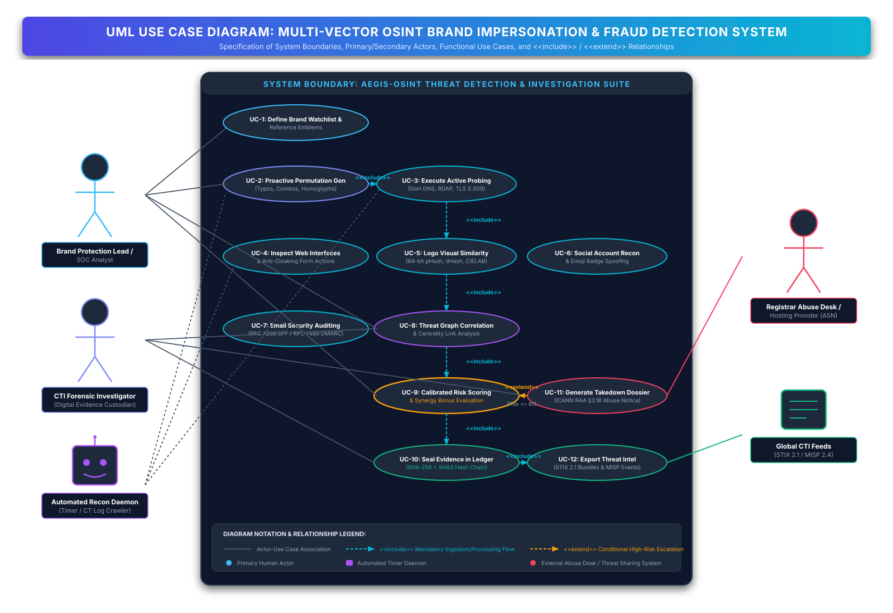
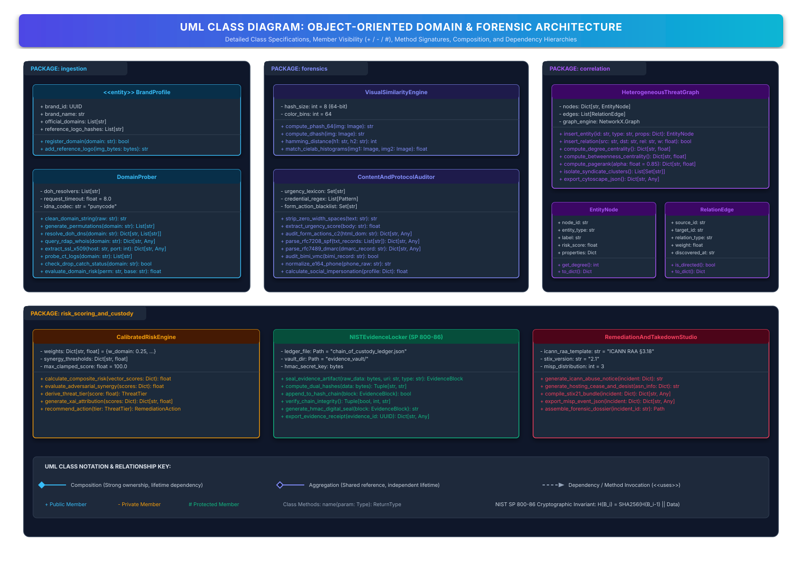
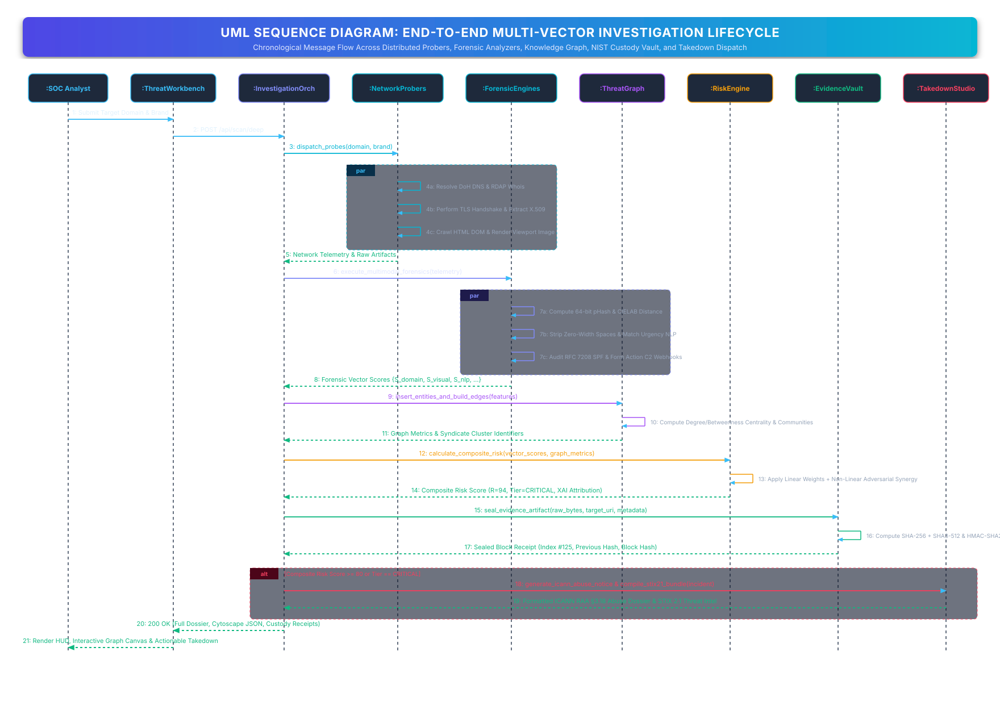
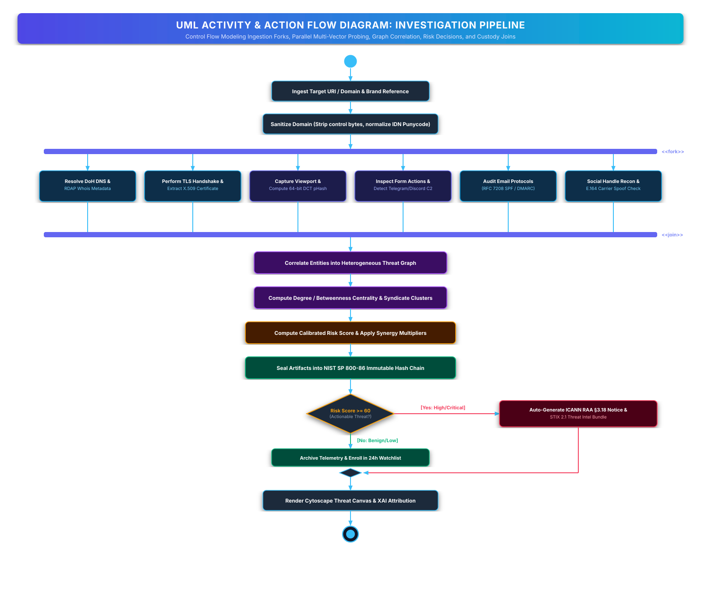
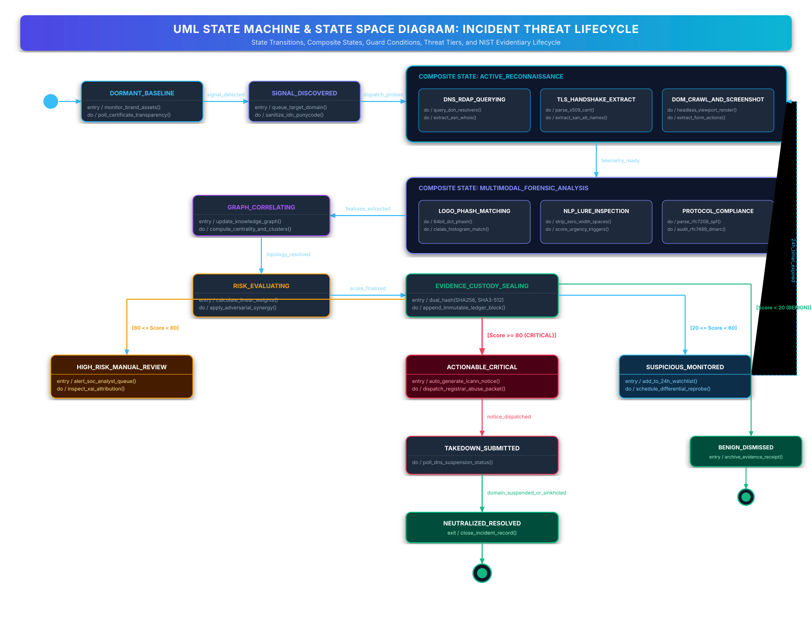
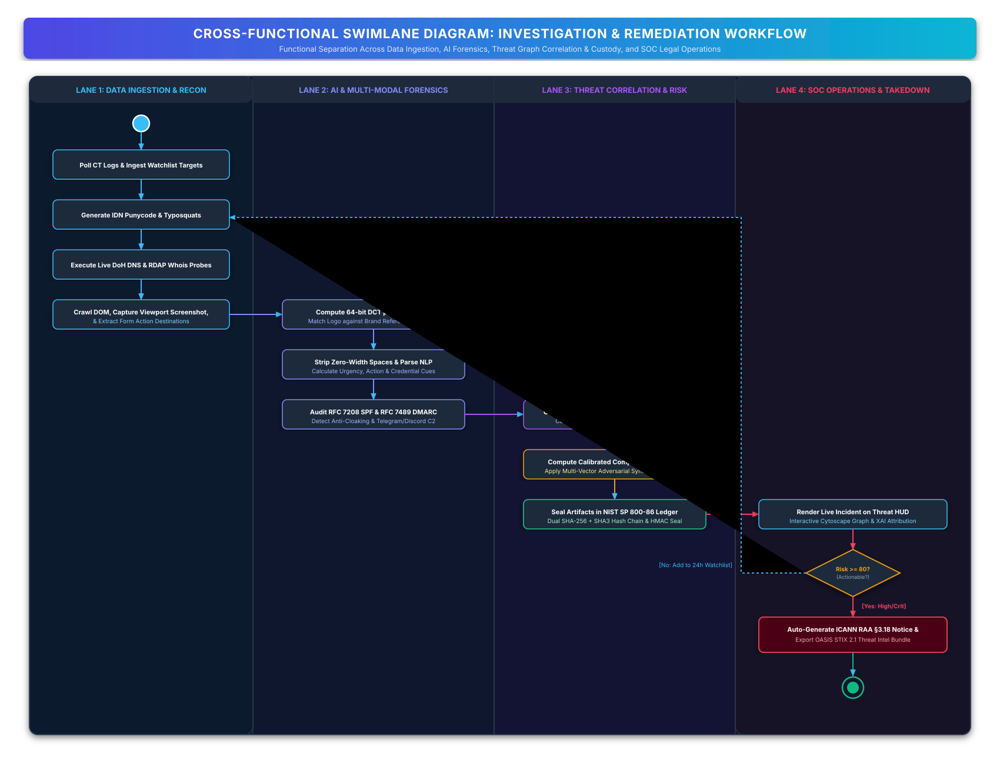
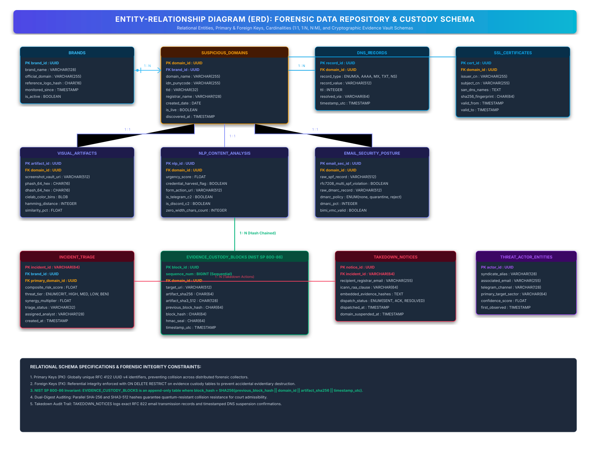
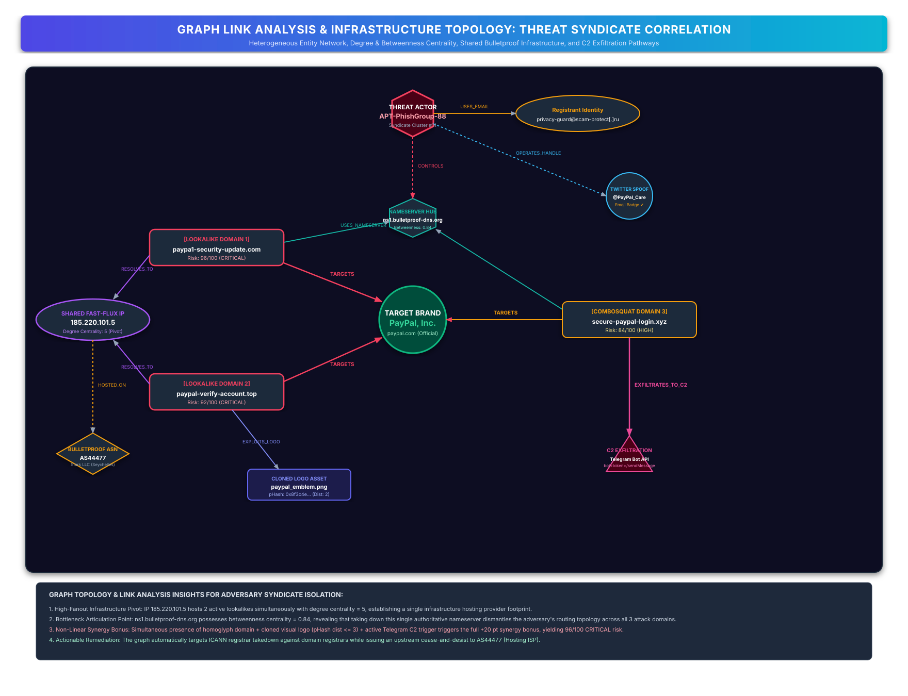

# OSINT Fraud & Brand Impersonation Detection: Formal Architectural Diagrams

**Document Classification**: Academic Research & System Design Report  
**Standard Compliance**: UML 2.5, NIST SP 800-86, RFC 3492, RFC 7208, RFC 7489, OASIS STIX 2.1  
**Authoring & Editing Formats**: Standalone High-Resolution SVG (`.svg`) & Native Draw.io XML (`.drawio`)  

---

## 🎯 Executive Problem Statement Alignment

This directory delivers the formal architectural and methodological design required to solve the following problem statement:

> **Problem Statement**:  
> *Design an OSINT system for detecting and investigating online fraud or brand impersonation, involving fake websites, social-media accounts, cloned logos, suspicious domains, and fraudulent communication. Evaluate suitable techniques for evidence validation, entity correlation, link analysis, risk scoring, and visualization. Develop a complete system architecture from data collection to investigation reporting and explain the role of each component. Define appropriate evaluation metrics for assessing the proposed system.*

Rather than documenting software artifacts in isolation, this design models the **methodological engineering blueprint** for how an autonomous, multi-vector Cyber Threat Intelligence (CTI) system investigates and dismantles online fraud syndicates.

---

## 📑 Master Diagram Index & Formats

All diagrams are provided in two interoperable formats:
1. **`.svg`**: Vector graphics that render natively inside GitHub, Markdown, web browsers, and academic reports.
2. **`.drawio`**: Standard XML models that can be opened and edited directly in [Draw.io / diagrams.net](https://app.diagrams.net/) or the VS Code Draw.io extension.

| # | Diagram Type | Rendered SVG | Editable Draw.io | Core Purpose & Problem Statement Mapping |
|---|:---|:---|:---|:---|
| **01** | **UML Use Case Diagram** | [**`01_USE_CASE_DIAGRAM.svg`**](01_USE_CASE_DIAGRAM.svg) | [**`01_USE_CASE_DIAGRAM.drawio`**](01_USE_CASE_DIAGRAM.drawio) | Defines the functional boundary, primary/secondary actors, and `<<include>>` / `<<extend>>` use case relationships. |
| **02** | **UML Class Diagram** | [**`02_CLASS_DIAGRAM.svg`**](02_CLASS_DIAGRAM.svg) | [**`02_CLASS_DIAGRAM.drawio`**](02_CLASS_DIAGRAM.drawio) | Object-oriented domain model, member visibility (`+`/`-`/`#`), method signatures, composition, and inheritance. |
| **03** | **UML Sequence Diagram** | [**`03_SEQUENCE_DIAGRAM.svg`**](03_SEQUENCE_DIAGRAM.svg) | [**`03_SEQUENCE_DIAGRAM.drawio`**](03_SEQUENCE_DIAGRAM.drawio) | Chronological message choreography, async parallel probing (`par`), risk escalation (`alt`), and evidence sealing. |
| **04** | **UML Activity Diagram** | [**`04_ACTIVITY_DIAGRAM.svg`**](04_ACTIVITY_DIAGRAM.svg) | [**`04_ACTIVITY_DIAGRAM.drawio`**](04_ACTIVITY_DIAGRAM.drawio) | Step-by-step control flow, fork/join concurrency for multimodal probes, decision gates, and terminal states. |
| **05** | **UML State Machine Diagram** | [**`05_STATE_MACHINE_DIAGRAM.svg`**](05_STATE_MACHINE_DIAGRAM.svg) | [**`05_STATE_MACHINE_DIAGRAM.drawio`**](05_STATE_MACHINE_DIAGRAM.drawio) | State-space representation of a threat incident, composite states, guard triggers, and evidentiary custody stages. |
| **06** | **Cross-Functional Swimlane** | [**`06_SWIMLANE_DIAGRAM.svg`**](06_SWIMLANE_DIAGRAM.svg) | [**`06_SWIMLANE_DIAGRAM.drawio`**](06_SWIMLANE_DIAGRAM.drawio) | Operational partitioning across Ingestion, AI Forensics, Graph Correlation, and SOC Legal Operations. |
| **07** | **Entity-Relationship Diagram** | [**`07_ENTITY_RELATIONSHIP_DIAGRAM.svg`**](07_ENTITY_RELATIONSHIP_DIAGRAM.svg) | [**`07_ENTITY_RELATIONSHIP_DIAGRAM.drawio`**](07_ENTITY_RELATIONSHIP_DIAGRAM.drawio) | Relational database schema, primary/foreign key mappings, cardinalities, and NIST SP 800-86 append-only ledger tables. |
| **08** | **Graph Link Analysis Diagram** | [**`08_GRAPH_LINK_ANALYSIS_DIAGRAM.svg`**](08_GRAPH_LINK_ANALYSIS_DIAGRAM.svg) | [**`08_GRAPH_LINK_ANALYSIS_DIAGRAM.drawio`**](08_GRAPH_LINK_ANALYSIS_DIAGRAM.drawio) | Heterogeneous threat network topology, pivot infrastructure identification, betweenness bottlenecks, and C2 links. |

---

## 🏛️ In-Depth Architectural & Methodological Walkthrough

### 1. UML Use Case Diagram (`01_USE_CASE_DIAGRAM`)

- **Actors**:
  - **Brand Protection Lead / SOC Analyst**: Defines brand watchlists, reviews automated alerts, and issues takedown approvals.
  - **CTI Forensic Investigator**: Oversees cryptographic evidence integrity, conducts deep-dive link analysis, and exports courtroom-ready dossiers.
  - **Automated Recon Daemon**: Background timer and Certificate Transparency (CT) crawler executing scheduled domain permuters.
  - **Registrar Abuse Desk / Hosting Provider (ASN)**: External secondary actor receiving automated ICANN RAA §3.18 notices.
  - **Global CTI Feeds (STIX 2.1 / MISP 2.4)**: Machine-to-machine sharing ecosystems consuming standardized IOCs.
- **Key Relationships**:
  - `UC-2 (Permutation Generation)` `<<include>>` `UC-3 (Active Probing)`.
  - All multi-vector probes `<<include>>` `UC-8 (Threat Graph Correlation)`.
  - `UC-8` `<<include>>` `UC-9 (Calibrated Risk Scoring)`.
  - `UC-9` conditionally `<<extend>>` `UC-11 (Takedown Dossier)` when `[Risk Score >= 80 or Critical Tier]`.
  - `UC-10 (NIST Evidence Sealing)` `<<include>>` `UC-12 (STIX / MISP Threat Intel Export)`.

---

### 2. UML Class Diagram (`02_CLASS_DIAGRAM`)

- **Layered Packages**:
  - **`ingestion`**: Encapsulates `BrandProfile` (official domains and reference logo hashes) and `DomainProber` (RFC 3492 Punycode normalizer, DNS-over-HTTPS probers, RDAP whois extractors, and CT log crawlers).
  - **`forensics`**: Implements `VisualSimilarityEngine` (64-bit DCT pHash, dHash, CIELAB histogram distance) and `ContentAndProtocolAuditor` (zero-width character removal, urgency regex matching, form action C2 detection, RFC 7208 SPF, and RFC 7489 DMARC).
  - **`correlation`**: Features `HeterogeneousThreatGraph` managing `EntityNode` and `RelationEdge` instances, computing Degree Centrality, Betweenness Centrality, and PageRank.
  - **`risk_scoring_and_custody`**: Houses `CalibratedRiskEngine` (linear factor weighting with non-linear synergy bonuses), `NISTEvidenceLocker` (parallel SHA-256 and SHA3-512 hashing, immutable hash chaining, and HMAC digital seals), and `RemediationAndTakedownStudio` (ICANN notice generation, STIX 2.1 bundling, and MISP 2.4 events).

---

### 3. UML Sequence Diagram (`03_SEQUENCE_DIAGRAM`)

- **Message Choreography**:
  1. **Initiation**: SOC Analyst submits target domain/URL via Workbench UI.
  2. **Orchestration**: `InvestigationOrchestrator` receives the request and triggers concurrent parallel probes (`par`) for DNS/RDAP resolution, TLS X.509 handshake, and headless DOM screenshot rendering.
  3. **Forensic Feature Extraction**: Telemetry is dispatched to forensic engines in parallel (`par`) to calculate logo pHash, NLP urgency, form action C2 webhooks, and SPF/DMARC compliance.
  4. **Graph Integration**: Disjoint indicators are correlated into `ThreatGraph`, deriving degree centrality and identifying infrastructure clusters.
  5. **Calibrated Risk Synthesis**: `RiskEngine` calculates composite risk score, factoring in non-linear adversarial synergy rules.
  6. **Evidence Sealing**: Raw bytes and metadata are committed to `EvidenceVault` (NIST SP 800-86), computing dual SHA-256/SHA3-512 hashes and generating an HMAC-SHA256 seal.
  7. **Conditional Remediation (`alt`)**: If `Risk Score >= 80`, `TakedownStudio` auto-generates the formal ICANN RAA §3.18 notice and STIX 2.1 intelligence bundle.
  8. **Response Delivery**: The complete forensic dossier, Cytoscape network graph, and custody block receipt are returned to the analyst.

---

### 4. UML Activity / Action Diagram (`04_ACTIVITY_DIAGRAM`)

- **Control Flow**:
  - **Input Sanitization**: Normalizes IDN Punycode and strips null bytes and Bi-directional (Bidi) overrides.
  - **Fork Concurrency (`<<fork>>`)**: Splits execution across 6 simultaneous investigative threads:
    1. *DNS & RDAP Metadata*
    2. *TLS X.509 Certificate Handshake*
    3. *Visual Viewport Rendering & 64-bit DCT pHash*
    4. *HTML Form Action C2 Destination Auditing*
    5. *RFC 7208 SPF & RFC 7489 DMARC Verification*
    6. *Social Handle & Phone Carrier Reconnaissance*
  - **Join Synchronization (`<<join>>`)**: Merges telemetry to update the threat graph, compute centrality, aggregate calibrated weights, and commit evidence to the NIST ledger.
  - **Decision Gate (`[Risk >= 60?]`)**:
    - *Yes (Actionable)*: Auto-generates ICANN takedown notices and triggers high-priority SOC alerting.
    - *No (Benign/Low)*: Archives telemetry and enrolls domain into a 24-hour differential monitoring watchlist.
  - **Terminal Render**: Updates interactive Cytoscape canvas and XAI attribution breakdown before concluding at the final activity node.

---

### 5. UML State Machine / State Space Diagram (`05_STATE_MACHINE_DIAGRAM`)

- **Lifecycle States**:
  - `DORMANT_BASELINE`: Continuous background monitoring of official brand footprints.
  - `SIGNAL_DISCOVERED`: New permutation, typosquat, or feed indicator detected.
  - `ACTIVE_RECONNAISSANCE` *(Composite)*: Substates for DNS querying, TLS parsing, and DOM scraping.
  - `MULTIMODAL_FORENSICS` *(Composite)*: Substates for pHash logo matching, NLP lure parsing, and protocol auditing.
  - `GRAPH_CORRELATING`: Knowledge graph update and centrality topology resolution.
  - `RISK_EVALUATING`: Linear factor weighting and non-linear synergy multiplier execution.
  - `EVIDENCE_CUSTODY_SEALING`: Cryptographic dual-hashing and immutable ledger block appending.
  - **Threat Tier Branches**:
    - `[Score >= 80]` -> `ACTIONABLE_CRITICAL` -> `TAKEDOWN_SUBMITTED` -> `NEUTRALIZED_RESOLVED`
    - `[60 <= Score < 80]` -> `HIGH_RISK_MANUAL_REVIEW` -> Analyst validation gate.
    - `[20 <= Score < 60]` -> `SUSPICIOUS_MONITORED` -> 24-hour differential re-probing loop.
    - `[Score < 20]` -> `BENIGN_DISMISSED` -> Archived.

---

### 6. Cross-Functional Swimlane Diagram (`06_SWIMLANE_DIAGRAM`)

- **Four Functional Lanes**:
  1. **Lane 1: Data Ingestion & Recon**: Responsible for CT log harvesting, Punycode permutation generation, DoH DNS querying, and headless DOM rendering.
  2. **Lane 2: AI & Multi-Modal Forensics**: Executes 64-bit DCT pHash comparison, NLP urgency token extraction, anti-cloaking form inspection, and SPF/DMARC auditing.
  3. **Lane 3: Threat Correlation & Risk**: Handles NetworkX knowledge graph mapping, degree/betweenness centrality, composite risk calculation, and NIST SP 800-86 hash chain sealing.
  4. **Lane 4: SOC Operations & Takedown**: Houses the interactive analyst HUD, Cytoscape graph canvas, automated ICANN RAA §3.18 abuse dispatch, and domain suspension tracking.

---

### 7. Entity-Relationship Diagram (ERD) (`07_ENTITY_RELATIONSHIP_DIAGRAM`)

- **Relational Schema Design**:
  - `BRANDS` (1) has many `SUSPICIOUS_DOMAINS` (N).
  - `SUSPICIOUS_DOMAINS` (1) maintains one-to-many child records for `DNS_RECORDS` and one-to-one records for `SSL_CERTIFICATES`, `VISUAL_ARTIFACTS`, `NLP_CONTENT_ANALYSIS`, and `EMAIL_SECURITY_POSTURE`.
  - **NIST SP 800-86 Custody Invariant**: `EVIDENCE_CUSTODY_BLOCKS` forms an immutable, append-only sequential ledger where each block embeds the SHA-256 hash of the preceding block:
    $$H(B_i) = \text{SHA256}(H(B_{i-1}) \mathbin{\Vert} \text{domain\_id} \mathbin{\Vert} \text{artifact\_sha256} \mathbin{\Vert} \text{timestamp\_utc})$$
  - `INCIDENT_TRIAGE` tracks composite risk scores and spawns child `TAKEDOWN_NOTICES` detailing registrar transmission timestamps and suspension confirmations.

---

### 8. Graph-Based Link Analysis & Network Topology Diagram (`08_GRAPH_LINK_ANALYSIS_DIAGRAM`)

- **Threat Syndicate Topology (PayPal Impersonation Case Study)**:
  - **Target Node**: `PayPal, Inc.` (Official Brand Target).
  - **Attack Nodes**: `paypa1-security-update.com` (Risk 96), `paypal-verify-account.top` (Risk 92), `secure-paypal-login.xyz` (Risk 84).
  - **High-Fanout Infrastructure Pivot**: Shared bulletproof IP `185.220.101.5` exhibits degree centrality = 5, exposing the shared hosting infrastructure.
  - **Critical Bottleneck Articulation Point**: Authoritative nameserver `ns1.bulletproof-dns.org` exhibits betweenness centrality = 0.84. Dismantling this single nameserver collapses DNS routing for the entire criminal campaign.
  - **Non-Linear Synergy Trigger**: The simultaneous presence of an IDN lookalike domain + exact logo visual clone (pHash distance = 2) + active Telegram C2 exfiltration webhook (`api.telegram.org/bot<token>/sendMessage`) triggers the full +20 pt synergy bonus, driving the incident into the `CRITICAL` tier.

---

## 🛠️ Viewing & Editing Instructions

1. **Direct GitHub Viewing**: Simply click any of the `.svg` links in the table above to view the high-resolution vector diagrams directly in your browser.
2. **Interactive Editing via Draw.io**:
   - Navigate to [https://app.diagrams.net/](https://app.diagrams.net/)
   - Click **File** -> **Open From** -> **Device...**
   - Select any `.drawio` file from this directory (e.g. `01_USE_CASE_DIAGRAM.drawio`).
3. **VS Code Integration**:
   - Install the *Draw.io Integration* extension (`hediet.vscode-drawio`).
   - Open any `.drawio` file directly inside the IDE editor.
